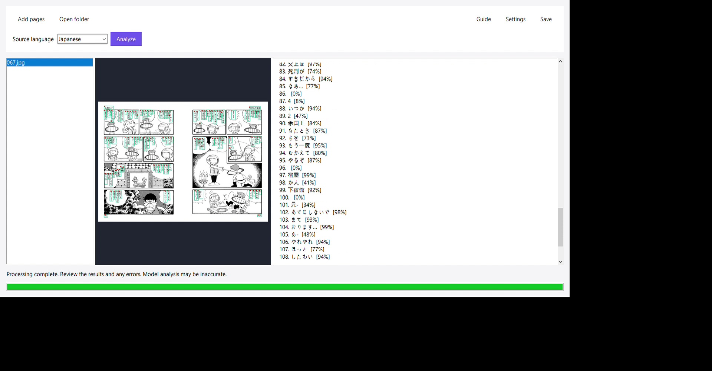
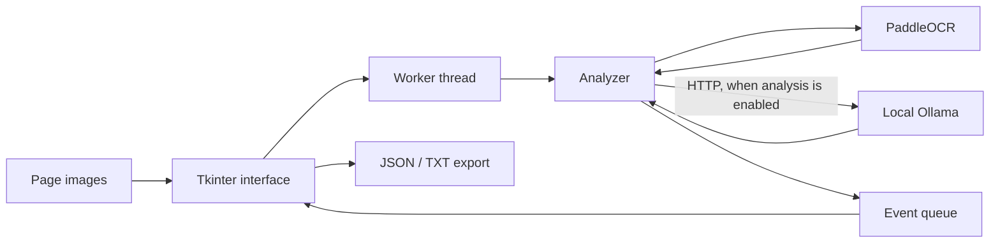

# Manga Reader

I am developing a local desktop application for manga OCR, dialogue translation, and page analysis. Manga Reader displays detected text regions over the image, keeps OCR results, and can use a local model through Ollama to describe scenes and characters in English.

The page list is on the left, the image preview is in the center, and OCR text and analysis appear on the right after processing.

[Quick start](#quick-start) · [Architecture](#current-architecture) · [Image processing](#from-image-loading-to-ocr-results) · [Known limitations](#limitations-and-known-issues) · [OCR research](#research)

## Demo

I demonstrate full-page OCR in the English interface: processing a Japanese manga page, displaying detected text regions, and reviewing recognized text with confidence scores.

[](https://github.com/b4rtoss/manga-reader/blob/main/docs/media/manga-reader-demo.mp4)

[Watch or download the demo (MP4, 14 seconds)](https://github.com/b4rtoss/manga-reader/raw/refs/heads/main/docs/media/manga-reader-demo.mp4).

## Application features

- Add individual images or a chapter folder, with natural page-number sorting.
- Detect and recognize text using PaddleOCR, displaying region outlines and confidence.
- Select Japanese, English, or Russian as the source language.
- Run OCR without Ollama.
- Translate dialogue into English and describe scenes and characters using local Ollama with `qwen3-vl:4b-instruct`.
- Pass a shortened context from preceding pages during sequential analysis.
- Export JSON with coordinates or a plain text file.

## Quick start

The standard Windows installation requires Python 3.12.

1. Download or clone the repository and open its folder.
2. Run `Install.cmd` to create the environment and install dependencies.
3. If you want dialogue translation and scene analysis, install [Ollama](https://ollama.com/download/windows), start it, and download the model:

   ```powershell
   ollama pull qwen3-vl:4b-instruct
   ```

4. Open `Launch.cmd`. To work without Ollama, open **Settings** and clear **Scenes, characters and story (Ollama)**.
5. Add images or a chapter folder, select the source language, and click **Analyze**.
6. Review the regions and text. **Save** exports the results as JSON or TXT.

Supported formats are JPG, JPEG, PNG, WebP, BMP, and TIFF. OCR models are downloaded on the first run. PaddleOCR runs on the CPU, so page processing can take considerable time.

The application is under development. OCR, translations, and analysis can contain errors; OCR confidence is not translation accuracy. See [known limitations](#limitations-and-known-issues) and the [setup guide](START.md).

## Current architecture

I build Manga Reader as a local desktop application with separate interface and processing modules. The main application runs in one process; Ollama runs separately and is accessed through a local HTTP API.

| Component | Responsibility |
| --- | --- |
| [`manga_app/app.py`](manga_app/app.py) | Tkinter interface, page list, preview, processing queue controls, result display, and export |
| [`manga_app/engine.py`](manga_app/engine.py) | Image loading, the `Analyzer` class, OCR calls, and Ollama requests |
| PaddleOCR | Page text detection and recognition, region coordinates, and confidence; the application uses CPU |
| Ollama | Local image analysis, dialogue translation, and scene descriptions; the default model is `qwen3-vl:4b-instruct` |
| `queue.Queue` | Status and result delivery from the worker thread to the interface |



Pages are processed sequentially in a background thread so long model calls do not block the interface. For each page, I first run PaddleOCR. If story analysis is enabled, I send Ollama a resized image, recognized text, and shortened context from earlier pages in the current run. OCR-only mode does not call Ollama.

Results remain in memory until export. Stopping ends the queue after the current page. If an Ollama analysis request fails after successful OCR, the recognized text is retained with a warning.

PaddleOCR currently handles both detection and recognition, providing the coordinates needed to draw regions on the page. I use it as a ready-to-integrate pipeline. Among the three baseline OCR systems evaluated on 3116 crops, Manga OCR produced the most accurate transcriptions.

## From image loading to OCR results

I organize page processing as follows:

1. **Add images.** The user selects files or a folder. The application accepts the supported image extensions, removes duplicate paths, and sorts filenames naturally: 1, 2, 10. The selected page appears in the preview.
2. **Start processing.** **Analyze** captures the source language and analysis settings, then processes all added pages sequentially in a worker thread. If Ollama analysis is enabled, the application first checks the service and selected model.
3. **Prepare the image.** `load_image()` opens the file with Pillow, applies its EXIF orientation, and converts it to RGB. The result record includes the path and the prepared image's width and height.
4. **Initialize OCR.** `Analyzer.initialize_ocr()` loads PaddleOCR on the first call or a language change. The application uses PP-OCRv5 on CPU. Document orientation classification, document unwarping, and text-line orientation are disabled. Model downloads may be needed on the first run.
5. **Detect and recognize text.** The RGB image becomes a NumPy array, its channels are reordered to BGR, and it is passed to `PaddleOCR.predict()`. PaddleOCR performs detection and recognition. The application does not separately downscale, binarize, or denoise the page before this call; PaddleOCR handles its internal preprocessing.
6. **Build the OCR record.** The application extracts `rec_texts`, `rec_scores`, and `rec_polys`. Each region has `text`, `confidence`, and `polygon` fields. Regions are sorted into horizontal bands 100 pixels high, right to left within a band for Japanese and left to right for the other languages. This approximate order does not recover panel structure.
7. **Display the result.** In OCR-only mode, the record is sent through `queue.Queue` to the main thread. The interface stores it in memory and updates progress. For the selected page, it lists recognized fragments with confidence percentages and draws numbered region outlines. Outlines are drawn before the image is reduced for display, so they scale with the preview.
8. **Export.** **Save** writes JSON containing text, confidence, and coordinates, or a TXT representation. Results remain in memory until export.

With story analysis enabled, an additional Ollama request runs between steps 6 and 7. It receives an image copy bounded by 2048 × 2048 pixels, OCR text, and shortened previous-page context. English analysis and dialogue translations are added to the same record. This resized copy is for Ollama, not for the OCR call.

An image-reading error or an OCR failure in OCR-only mode creates an error record for the page. If OCR fails while story analysis is enabled, the application can continue with direct image analysis and add a warning. If subsequent Ollama analysis fails, existing recognized text is preserved. An empty region list is shown as no text found; OCR confidence is not measured transcription accuracy.

## Planned improvements

The architecture is still being refined. I plan to evaluate **PaddleOCR for detection, Manga OCR for crop recognition, and Ollama for page analysis**. This combination is not implemented in the application yet. Before adopting it, I need to evaluate full-page detection separately and compare accuracy and runtime with the current pipeline.

## Research

To assess Japanese manga OCR approaches, I separately compare Tesseract, PaddleOCR, Manga OCR, ChatGPT, and MangaLMM. The research covers dataset preparation, shared evaluation metrics, and error analysis, informing future improvements to the application.

The [research report](docs/experiment-results.md) contains the full methodology and results. The [verification report](docs/verification.md) covers runtime checks of the application.

### Research implementation

- Generate text-region images from XML annotations and save reference transcriptions to CSV.
- Run batch OCR using Tesseract, PaddleOCR, and Manga OCR.
- Run MangaLMM on full pages and tiles.
- Match predictions to references, including a separate comparison with ChatGPT on 50 examples.
- Calculate recognition quality, recorded processing time, and empty predictions.
- Export results for error analysis.

### My hardware

I run the experiments locally on this laptop:

| Component | Specification |
| --- | --- |
| Platform | ARDOR GAMING, NP5x_60_7x_RNx1 |
| Operating system | Windows 10 Home, x64, build 19045 |
| Processor | Intel Core i5-12450H, 8 cores and 12 threads |
| RAM | 16 GB |
| GPU | NVIDIA GeForce RTX 4050 Laptop GPU |
| Dedicated VRAM | 6 GB |

VRAM limits the MangaLMM configuration: I use 4-bit quantization and a reduced input-image pixel budget for local inference.

### OCR systems and selection rationale

I compare systems with different specializations and tasks:

| System | Description | Why I include it |
| --- | --- | --- |
| [Tesseract](https://github.com/tesseract-ocr/tesseract) | General-purpose OCR engine | Baseline for comparison with manga-specific recognition |
| [PaddleOCR](https://www.paddleocr.ai/latest/en/version3.x/pipeline_usage/OCR.html) | Text detection and recognition pipeline | Ready-to-use neural OCR comparison and, in the application, text and coordinates from a whole page |
| [Manga OCR](https://github.com/kha-white/manga-ocr) | Japanese text recognizer focused on manga | Test the benefit of domain specialization on prepared crops |
| ChatGPT | Service providing general-purpose multimodal models | Transcribe the same 50 crops and examine the influence of language context |
| [MangaLMM](https://github.com/manga109/MangaLMM) | Manga-specific multimodal model | Separate experiment on text detection, coordinates, and recognition on full pages |

I currently use PaddleOCR in Manga Reader because one pipeline returns text, coordinates, and confidence. Manga OCR performed best among the three baseline systems on 3116 crops, but it needs a separate detector for full-page processing. I plan to evaluate that combination during further development.

Detailed descriptions and limitations are in the [research report](docs/experiment-results.md#ocr-systems-and-selection-rationale).

### Comparison methodology

I separate the 3116-crop baseline, the four-system comparison on the same 50 crops with seed 42, and MangaLMM evaluation on 50 full images from the official MangaOCR test split.

For crops, I apply NFKC normalization and remove whitespace from references and predictions, calculate corpus-level CER and Exact Match, and check file correspondence and missing results.

For MangaLMM, I scale boxes back to the original image and match regions one to one at IoU ≥ 0.5. I calculate detection metrics and end-to-end scores incorporating text similarity. The scaled evaluator removes whitespace from text but does not apply NFKC.

Formulas, sample selection, empty-answer handling, matching, and timing boundaries are specified in the [comparison methodology](docs/experiment-results.md#comparison-methodology).

### Quality metrics

| Metric | Meaning |
| --- | --- |
| Character Error Rate (CER) | Total Levenshtein distance divided by total reference characters; lower is better |
| Exact Match | Fraction of examples matching the reference completely after normalization |
| Empty predictions | Number of empty recognized strings |
| Average inference time | Average recorded call duration; model loading is measured separately from individual recognition calls |

I compare systems on the same sample with the same normalization. Timing depends on hardware and the runner. Failed baseline calls remain in CER and Exact Match, but `evaluate_results.py` averages latency only across successful calls. Models are initialized before calls are timed.

### Research results

On 3116 Hamlet crops, Manga OCR achieved **9.13% CER** and **70.64% Exact Match**. Tesseract achieved 97.74% and 2.54%, and PaddleOCR 81.45% and 4.91%, respectively.

On the separate fixed sample of 50 crops:

| System | CER ↓ | Exact Match ↑ |
| --- | ---: | ---: |
| Tesseract | 97.92% | 4% |
| PaddleOCR | 80.76% | 12% |
| Manga OCR | 7.45% | 76% |
| ChatGPT | 6.24% | 80% |

ChatGPT matched 40 examples exactly, compared with 38 for Manga OCR. I treat this difference as preliminary. Recalculation requires the original ChatGPT responses and the corresponding run settings to be added to the repository.

MangaLMM is evaluated separately on full pages. After coordinate scaling was corrected, the 50-image official MangaOCR test sample yielded **3.87% Detection Hmean** and **0.86% End-to-end Hmean** with NED similarity. The local run used the RTX 4050, 4-bit quantization, and a reduced pixel budget. These scores assess localization and recognition together and are separate from crop CER.

### Main research files

| File | Purpose |
| --- | --- |
| [prepare_dataset.py](prepare_dataset.py) | Generate crops and `ground_truth.csv` from `Hamlet/Hamlet.xml` |
| [run_mangaocr_batch.py](run_mangaocr_batch.py) | Batch Manga OCR with per-example results |
| [run_tesseract_batch.py](run_tesseract_batch.py) | Batch Tesseract OCR |
| [run_paddle_batch.py](run_paddle_batch.py) | Batch PaddleOCR |
| [evaluate_results.py](evaluate_results.py) | Baseline CER, Exact Match, and timing evaluation |
| [prepare_chatgpt_50.py](prepare_chatgpt_50.py) | Prepare a sample for the ChatGPT comparison |
| [compare_ocr_test50.py](compare_ocr_test50.py) | Compare four systems on the same sample |
| [run_mangallmm_fullpages.py](run_mangallmm_fullpages.py) | MangaLMM full-page inference |
| [run_mangallmm_tiled.py](run_mangallmm_tiled.py) | MangaLMM tiled inference |

### Run a baseline experiment

The following starts with Manga OCR; the other engines require their own setup.

1. Clone the repository and open its directory.
2. Create an environment and install benchmark dependencies:

   ```powershell
   python -m venv .venv
   .\.venv\Scripts\Activate.ps1
   python -m pip install -r requirements-benchmark.txt
   ```

3. Ensure that the images and `Hamlet.xml` are in `Hamlet`. Follow the rightsholders' terms when using the source data.
4. Run `python prepare_dataset.py`.
5. By default, data and results use the repository directory. Set `OCR_BENCHMARK_DIR` or pass `--dataset-dir`, `--ground-truth`, and `--output` to use another location.
6. Run `python run_mangaocr_batch.py`.

Results contain `file`, `ground_truth`, `prediction`, `time_sec`, and `status`. The first run may need model downloads. Add `--limit 3` for a smoke test or `--resume` to continue. Resume keeps existing rows, including errors; without it, the results file is recreated. Failed samples produce a nonzero exit code and retain details in `status`.

```powershell
python run_paddle_batch.py --limit 3
python run_tesseract_batch.py --limit 3 --tesseract-cmd "C:\Program Files\Tesseract-OCR\tesseract.exe"
python evaluate_results.py results_mangaocr.csv --output report.csv
python prepare_chatgpt_50.py --size 50 --seed 42
python -m unittest discover -s tests -v
```

Install the Tesseract executable and `jpn` language data separately. The runner uses PATH unless `--tesseract-cmd` is provided. PaddleOCR defaults to CPU; `--device gpu:0` requires a compatible PaddlePaddle GPU/CUDA/cuDNN installation.

`evaluate_results.py` accepts one or more CSV files. Without arguments, it expects all three baseline files. With multiple files, it verifies that examples and normalized references match. Empty CSV files and duplicate sample filenames are errors.

MangaLMM scripts also use the repository's Hamlet pages by default. For a complete external Manga109 dataset, set `MANGA109_ROOT` to a directory containing `images/` and `annotations/`. Preparing the official sample across multiple books requires that complete dataset. MangaLMM needs a separate environment with CUDA, PyTorch, Transformers, Accelerate, bitsandbytes, qwen-vl-utils, and datasets; these are separate from the standard application installation.

## My contribution

In this project, I:

- Automate preparation of 3116 Hamlet crops and reference CSV data from XML annotations.
- Compare Tesseract, PaddleOCR, and Manga OCR on the same data using CER, Exact Match, empty predictions, and recorded runtime.
- Compare five systems qualitatively on one image and examine omissions, distorted text, and duplicate regions.
- Build a fixed 50-crop comparison with ChatGPT and analyze cases where language context changes the original text.
- Adapt MangaLMM to a 6 GB RTX 4050 using 4-bit quantization and a reduced input pixel budget.
- Investigate 2 × 2 tiled inference, full-page coordinate conversion, result merging, and duplicate removal.
- Correct coordinate matching after Qwen image resizing using `image_grid_thw`; the corrected evaluation finds 37 spatial matches instead of zero.
- Evaluate detection and end-to-end OCR on 50 images from the official MangaOCR test split.
- Integrate OCR and local Ollama into Manga Reader with region previews and result export.

I use Codex to help verify and improve the code. This work includes path and error-handling fixes, command-line options, incremental result saving, and 14 automated tests. Research results and application checks are documented separately.

## Limitations and known issues

### Recognition and analysis quality

- The main OCR comparison uses crops from one manga, Hamlet. The ChatGPT comparison uses 50 crops. I do not generalize these results to every manga, language, or scan type.
- Vertical lettering, handwriting, stylized sound effects, and complex panel layouts may be recognized incorrectly. The application's approximate region order does not recover panel structure.
- PaddleOCR handles both detection and recognition in the current application. Full-page detection quality still needs separate evaluation; integrating Manga OCR remains planned work.
- The local MangaLMM configuration produced low end-to-end scores. Six of 50 pages had no parsed detections. Reduced resolution and 4-bit quantization differ from the original research conditions.
- Ollama may omit details, repeat itself, or add unsupported interpretations. Review translations and analysis. OCR confidence is not measured transcription or translation accuracy.

### Performance and compatibility

- The standard application uses CPU PaddleOCR. During verification, one small crop took over a minute; full pages can take substantially longer.
- On the tested Windows configuration, PaddlePaddle 3.3.1 with oneDNN raised `ConvertPirAttribute2RuntimeAttribute`. The code disables oneDNN on Windows as a workaround, affecting available acceleration.
- A separate GPU environment raised `WinError 127` while loading `cudnn_cnn64_9.dll`. That compatibility issue is unresolved. The standard CPU installation does not require cuDNN; GPU inference requires matching libraries.
- First-time OCR setup requires model downloads. Scene analysis requires a running local Ollama service and the selected model.

### Current application limits

- **Stop** ends the queue after the current page and does not interrupt an active OCR call or Ollama request. Analysis requests use a 900-second HTTP timeout.
- Results stay in memory until manual export. Autosave and session recovery are not implemented. Running analysis again processes all added pages again.
- Image files are supported. PDF/CBZ import, automatic source-text removal, and translated-page typesetting are not implemented.

### Experiment reproducibility

- Original ChatGPT responses are not published, and the exact model version and run date were not recorded. Library versions and settings are incomplete for some research runs.
- Official MangaOCR sample selection depends on available local scans. Seed 42 fixes the random order, not sample representativeness.
- Crop and scaled MangaLMM evaluators normalize text differently. The 50-crop comparison script excludes missing rows, so `samples = 50` and `missing = 0` must be checked before comparison.
- Some MangaLMM parameters remain in research scripts, and that environment lacks a separately pinned, verified dependency set. The current baseline runner performs no separate warm-up or repeated timing series.
- Maintenance verification used automated tests and short smoke runs. The complete benchmark and MangaLMM were not rerun; I keep historical research results separate from current-version checks.

Coordinate matching for MangaLMM evaluation and old absolute paths have been corrected. Successful OCR survives a later Ollama failure. See the [experiment results](docs/experiment-results.md), [verification report](docs/verification.md), and [setup guide](START.md).
