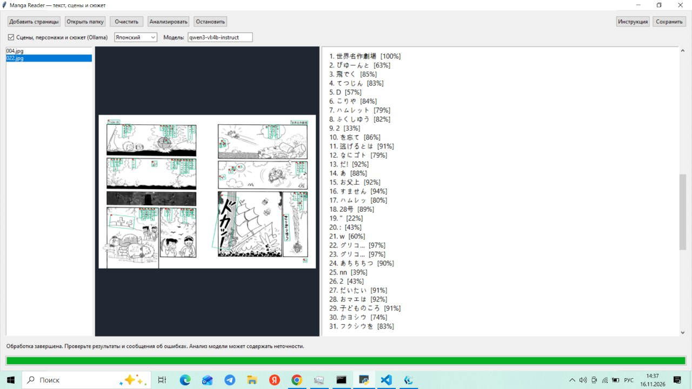
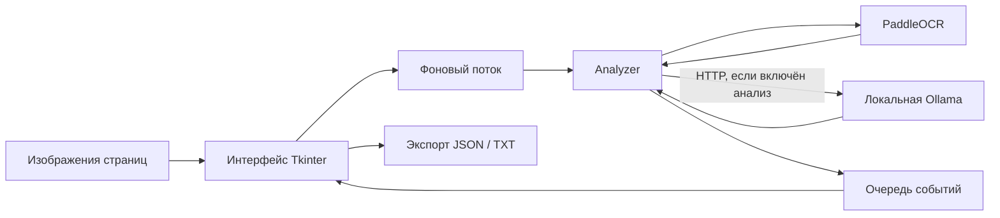

# Manga OCR Benchmark

В этом проекте я сравниваю качество распознавания японского текста в манге с помощью готовых OCR-систем и мультимодальных моделей. Я исследую OCR как отдельный этап автоматизации перевода: ошибки распознавания могут переходить в последующий перевод.

## Моё оборудование

Эксперименты я провожу локально на ноутбуке со следующей конфигурацией:

| Компонент | Характеристики |
| --- | --- |
| Платформа | ARDOR GAMING, NP5x_60_7x_RNx1 |
| ОС | Windows 10 Домашняя, x64, сборка 19045 |
| Процессор | Intel Core i5-12450H, 8 ядер и 12 потоков |
| Оперативная память | 16 ГБ |
| Видеокарта | NVIDIA GeForce RTX 4050 Laptop GPU |
| Выделенная видеопамять | 6 ГБ |

Объём видеопамяти ограничивает конфигурацию MangaLMM: для локального запуска я использую 4-битную квантизацию и уменьшаю разрешение входного изображения.

## Что реализовано

- Подготовка изображений текстовых областей по XML-аннотациям и сохранение эталонных транскрипций в CSV.
- Пакетное распознавание с Tesseract, PaddleOCR и Manga OCR.
- Скрипты запуска мультимодальной модели MangaLMM на полных страницах и фрагментах.
- Сопоставление предсказаний с эталоном, включая отдельное сравнение с результатами ChatGPT на выборке из 50 примеров.
- Расчёт метрик качества, времени обработки и количества пустых ответов.
- Экспорт результатов для анализа ошибок.

## OCR-системы и причины выбора

Для сравнения я выбираю системы с разной специализацией и разными задачами:

| Система | Что представляет собой | Почему я использую её |
| --- | --- | --- |
| [Tesseract](https://github.com/tesseract-ocr/tesseract) | Универсальный OCR-движок | Базовый вариант для сравнения с решениями, специализированными под мангу |
| [PaddleOCR](https://www.paddleocr.ai/latest/en/version3.x/pipeline_usage/OCR.html) | Пайплайн поиска и распознавания текста | Сравнение с готовым нейросетевым OCR, а в приложении — получение текста и координат областей из целой страницы |
| [Manga OCR](https://github.com/kha-white/manga-ocr) | Распознаватель японского текста, ориентированный на мангу | Проверка преимущества предметной специализации при чтении готовых кропов |
| ChatGPT | Сервис с мультимодальными моделями общего назначения | Сравнение транскрипций на тех же 50 кропах и анализ влияния языкового контекста |
| [MangaLMM](https://github.com/manga109/MangaLMM) | Специализированная мультимодальная модель для манги | Отдельный эксперимент с поиском текста и определением его координат на полной странице |

В текущем Manga Reader я использую PaddleOCR для детекции и распознавания, потому что он возвращает текст, координаты и уверенность в одном пайплайне. Среди трёх базовых OCR-систем на 3116 кропах лучший результат показал Manga OCR, но для работы с полной страницей ему нужен отдельный детектор. Связку PaddleOCR для детекции и Manga OCR для распознавания планирую проверить в дальнейшей доработке.

Подробные описания, ограничения и причины выбора каждой системы приведены в [отчёте](docs/experiment-results.md#ocr-системы-и-причины-выбора).

## Методология сравнения

Я разделяю три эксперимента: сравнение Tesseract, PaddleOCR и Manga OCR на 3116 одинаковых кропах, сравнение четырёх систем с ChatGPT на фиксированных 50 кропах (seed = 42) и отдельную оценку MangaLMM на 50 полных изображениях официального MangaOCR test split.

Для готовых кропов одинаково нормализую эталоны и предсказания через NFKC и удаление пробелов, затем рассчитываю CER по суммарному числу символов и Exact Match. Перед сравнением проверяю совпадение файлов и отсутствие пропусков результатов.

Для MangaLMM привожу координаты рамок к исходному размеру страницы и сопоставляю области один к одному при IoU ≥ 0,5. Рассчитываю метрики детекции и end-to-end показатели с учётом сходства текста. В scaled evaluator для текста удаляются пробелы, но NFKC не применяется.

Формулы, правила отбора выборок, учёт пустых ответов и ошибок, алгоритм сопоставления и границы измерения времени описаны в [методологии сравнения](docs/experiment-results.md#методология-сравнения).

## Как оценивается качество

В базовом сравнении текст приводится к Unicode NFKC, пробелы и переносы строк удаляются одинаково для всех систем.

| Метрика | Что показывает |
| --- | --- |
| Character Error Rate (CER) | Суммарное расстояние Левенштейна, делённое на количество символов эталона. Чем меньше, тем лучше. |
| Exact Match | Доля примеров, полностью совпавших с эталоном после нормализации. |
| Empty predictions | Количество пустых ответов. |
| Average inference time | Среднее записанное время распознавания. Загрузка модели измеряется отдельно от отдельных вызовов в базовом Manga OCR runner. |

Сравнивать модели следует на одной выборке и с одинаковой нормализацией. Метрики времени зависят от оборудования и реализации runner. Неуспешные вызовы учитываются в CER и Exact Match; среднее время считается только по успешным вызовам. Загрузка моделей выполняется до замера распознавания.

## Результаты исследования

Я сравниваю Tesseract, PaddleOCR и Manga OCR на 3116 текстовых кропах Hamlet из Manga109. Manga OCR показал CER **9,13%** и Exact Match **70,64%**. Для Tesseract значения составили 97,74% и 2,54%, для PaddleOCR — 81,45% и 4,91%.

Для отдельного сравнения с ChatGPT я использую **50 одинаковых кропов** с фиксированной случайной выборкой, seed = 42:

| Система | CER ↓ | Exact Match ↑ |
| --- | ---: | ---: |
| Tesseract | 97,92% | 4% |
| PaddleOCR | 80,76% | 12% |
| Manga OCR | 7,45% | 76% |
| ChatGPT | 6,24% | 80% |

На этой выборке ChatGPT получил 40 точных совпадений, Manga OCR — 38. Я рассматриваю эту разницу как предварительный результат. Для повторного расчёта нужно дополнить репозиторий исходными ответами ChatGPT и параметрами запуска.

MangaLMM я оцениваю отдельно в задаче OCR полной страницы. На 50 изображениях официального MangaOCR test split после исправления масштаба координат получены Detection Hmean **3,87%** и End-to-end Hmean с учётом NED **0,86%**. Для запуска на RTX 4050 с 6 ГБ VRAM я использую 4-битную квантизацию и ограниченный бюджет изображения. Эти метрики характеризуют поиск и распознавание областей на странице, поэтому я рассматриваю их отдельно от CER на готовых кропах.

Методику, результаты и анализ ошибок я описываю в [подробном отчёте](docs/experiment-results.md). Проверки запуска и обработки сбоев вынесены в [отдельный отчёт](docs/verification.md).

## Основные файлы

| Файл | Назначение |
| --- | --- |
| [prepare_dataset.py](prepare_dataset.py) | Подготовка кропов и ground_truth.csv из Hamlet/Hamlet.xml. |
| [run_mangaocr_batch.py](run_mangaocr_batch.py) | Пакетный запуск Manga OCR с записью результатов каждого примера. |
| [run_tesseract_batch.py](run_tesseract_batch.py) | Пакетный запуск Tesseract. |
| [run_paddle_batch.py](run_paddle_batch.py) | Пакетный запуск PaddleOCR. |
| [evaluate_results.py](evaluate_results.py) | Базовое сравнение OCR по CER, Exact Match и времени. |
| [prepare_chatgpt_50.py](prepare_chatgpt_50.py) | Подготовка выборки для сравнения с ChatGPT. |
| [compare_ocr_test50.py](compare_ocr_test50.py) | Сравнение четырёх систем на общей выборке. |
| [run_mangallmm_fullpages.py](run_mangallmm_fullpages.py) | Распознавание полных страниц с MangaLMM. |
| [run_mangallmm_tiled.py](run_mangallmm_tiled.py) | Распознавание страниц по фрагментам. |

## Запуск базового эксперимента

Ниже приведён путь для Manga OCR. Остальные модели требуют собственных зависимостей и настроек.

1. Клонируйте репозиторий и перейдите в его каталог.
2. Создайте виртуальное окружение и установите зависимости.

   ~~~powershell
   python -m venv .venv
   .\.venv\Scripts\Activate.ps1
   python -m pip install -r requirements-benchmark.txt
   ~~~

3. Убедитесь, что в Hamlet находятся изображения и Hamlet.xml. Для использования исходных данных учитывайте условия их правообладателей.
4. Подготовьте кропы и эталонные тексты.

   ~~~powershell
   python prepare_dataset.py
   ~~~

5. По умолчанию данные и результаты находятся в каталоге репозитория. Для другого каталога задайте переменную `OCR_BENCHMARK_DIR` или параметры `--dataset-dir`, `--ground-truth`, `--output` пакетного запуска.
6. Запустите распознавание.

   ~~~powershell
   python run_mangaocr_batch.py
   ~~~

Результат содержит file, ground_truth, prediction, time_sec и status. Первый запуск Manga OCR может потребовать загрузки весов модели.

Для пробного запуска добавьте `--limit 3`, для продолжения — `--resume`. Существующие строки при продолжении сохраняются, включая ошибки; без `--resume` результат создаётся заново. При ошибках runner завершает работу с ненулевым кодом и оставляет подробности в столбце `status`.

~~~powershell
python run_paddle_batch.py --limit 3
python run_tesseract_batch.py --limit 3 --tesseract-cmd "C:\Program Files\Tesseract-OCR\tesseract.exe"
python evaluate_results.py results_mangaocr.csv --output report.csv
python prepare_chatgpt_50.py --size 50 --seed 42
python -m unittest discover -s tests -v
~~~

Tesseract устанавливается отдельно с языковыми данными `jpn`; по умолчанию используется исполняемый файл из PATH. PaddleOCR запускается на CPU; `--device gpu:0` требует отдельной совместимой GPU-установки PaddlePaddle/CUDA/cuDNN.

В `evaluate_results.py` можно передать один или несколько CSV. Без аргументов ожидаются все три базовые системы. При нескольких CSV проверяется совпадение файлов и эталонных текстов, чтобы неполная выборка не улучшала рейтинг. Пустые CSV и повторяющиеся имена примеров считаются ошибкой.

Для MangaLMM-скриптов страницы Hamlet по умолчанию также берутся из репозитория. Для полного внешнего Manga109 задайте `MANGA109_ROOT` на каталог с `images/` и `annotations/`. Подготовка официальной выборки из разных книг требует именно такого полного набора. MangaLMM требует отдельного окружения с CUDA, PyTorch, Transformers, Accelerate, bitsandbytes, qwen-vl-utils и datasets; этот тяжёлый сценарий не входит в установку Manga Reader.

## Мой вклад

В рамках проекта я:

- Автоматизирую подготовку 3116 кропов Hamlet по XML-разметке и формирование CSV с эталонными транскрипциями.
- Сравниваю Tesseract, PaddleOCR и Manga OCR на одинаковых данных по CER, Exact Match, пустым ответам и времени обработки.
- Провожу качественное сравнение пяти систем на одном изображении и разбираю пропуски, искажения текста и повторные детекции.
- Формирую фиксированную выборку из 50 кропов для сравнения с ChatGPT и анализирую случаи, когда модель изменяет исходный текст по языковому контексту.
- Адаптирую запуск MangaLMM под RTX 4050 с 6 ГБ VRAM с помощью 4-битной квантизации и ограничения бюджета изображения.
- Исследую обработку страниц по сетке 2 × 2, объединение результатов в координатах страницы и удаление дубликатов.
- Исправляю сопоставление координат после изменения размера входа Qwen с использованием `image_grid_thw`. После коррекции оценщик находит 37 пространственных совпадений вместо нуля.
- Оцениваю детекцию и end-to-end OCR на 50 изображениях официального MangaOCR test split.
- Интегрирую OCR и локальную Ollama в Manga Reader с просмотром областей текста и экспортом результатов.

Для технической проверки и доработки кода я использую Codex. С его помощью исправлены пути и обработка ошибок, добавлены параметры запуска, сохранение промежуточных результатов и 13 автоматических тестов. Результаты экспериментов и проверки приложения описаны в отдельных отчётах.

## Текущие ограничения

- Часть параметров исследовательских MangaLMM-скриптов всё ещё задаётся в коде.
- Зависимости приложения и базового бенчмарка разделены; зависимости исследовательского MangaLMM-окружения отдельно не зафиксированы.
- Полный цикл перевода и вёрстки переведённых страниц в этом репозитории не описан.
- Исследовательские результаты уже получены, но для полного воспроизведения нужно восстановить исходные ответы ChatGPT и зафиксировать версии и настройки каждого запуска. Условия и ограничения описаны в [отчёте о результатах](docs/experiment-results.md).

## Приложение Manga Reader

Распознавание японского текста на странице манги. Слева — список страниц, в центре — найденные текстовые области, справа — распознанный текст с оценками уверенности OCR.

В репозитории также есть настольное приложение на Tkinter для анализа собственных изображений страниц без XML-аннотаций.

- Добавление отдельных изображений или папки главы с сортировкой по номерам страниц.
- OCR на PaddleOCR с отображением найденных областей поверх изображения.
- Выбор японского, английского или русского языка оригинала.
- Перевод реплик, описание сцен и персонажей через локальную Ollama с моделью qwen3-vl:4b-instruct.
- Передача сокращённого контекста предыдущих страниц при последовательном анализе.
- Экспорт результатов в JSON или текст.

### Текущая архитектура

Manga Reader я разрабатываю как локальное настольное приложение с разделением интерфейса и обработки данных. Основное приложение работает в одном процессе, а Ollama запускается отдельно и доступна через локальный HTTP API.

| Компонент | Ответственность |
| --- | --- |
| [`manga_app/app.py`](manga_app/app.py) | Интерфейс Tkinter, список страниц, предпросмотр, запуск и остановка очереди, отображение результатов и экспорт |
| [`manga_app/engine.py`](manga_app/engine.py) | Загрузка изображений, класс `Analyzer`, вызов OCR и запросы к Ollama |
| PaddleOCR | Поиск и распознавание текста на странице, координаты областей и оценка уверенности. В приложении используется CPU |
| Ollama | Локальный анализ изображения, перевод реплик и описание сцен. Модель по умолчанию — `qwen3-vl:4b-instruct` |
| `queue.Queue` | Передача статусов и результатов из фонового потока в интерфейс |

Страницы обрабатываются последовательно в фоновом потоке, чтобы длительные вызовы моделей не блокировали интерфейс. Для каждой страницы я сначала запускаю PaddleOCR. Если включён анализ сюжета, передаю в Ollama уменьшенное изображение, распознанный текст и сокращённый контекст предыдущих страниц текущего запуска. В режиме только OCR обращение к Ollama не требуется.

Результаты хранятся в памяти приложения и экспортируются в JSON или TXT. Остановка завершает очередь после текущей страницы. Если запрос анализа Ollama завершается ошибкой после успешного OCR, распознанный текст сохраняется вместе с предупреждением.

PaddleOCR в текущей версии закрывает и детекцию, и распознавание: его координаты позволяют отображать найденные области поверх страницы. Я использую его как готовый компонент для этого сценария; среди трёх базовых OCR-систем на 3116 кропах наиболее точным оказался Manga OCR.

### Обработка изображения от загрузки до результата OCR

Я организую обработку страницы следующим образом:

1. **Добавление изображения.** Пользователь выбирает отдельные файлы или папку. Приложение принимает JPG, JPEG, PNG, WebP, BMP и TIFF, убирает повторяющиеся пути и сортирует имена с учётом чисел: 1, 2, 10. Выбранная страница появляется в предпросмотре.

2. **Запуск обработки.** По кнопке «Анализировать» приложение фиксирует язык оригинала и настройки анализа, затем запускает последовательную обработку всех добавленных страниц в фоновом потоке. Если включён анализ через Ollama, сначала проверяет доступность сервиса и наличие выбранной модели.

3. **Подготовка изображения.** Функция `load_image()` открывает файл через Pillow, применяет ориентацию из EXIF и переводит изображение в RGB. В записи результата сохраняются путь к файлу, ширина и высота подготовленного изображения.

4. **Подготовка OCR.** `Analyzer.initialize_ocr()` загружает PaddleOCR при первом вызове или смене языка. В приложении используется PP-OCRv5 на CPU. Определение ориентации документа, исправление его геометрии и определение ориентации текстовых строк отключены. На первом запуске библиотеке может потребоваться загрузить модели.

5. **Поиск и распознавание текста.** RGB-изображение преобразуется в массив NumPy, каналы переставляются в порядок BGR, после чего массив передаётся в `PaddleOCR.predict()`. Библиотека выполняет поиск текстовых областей и распознавание. В коде приложения перед этим вызовом нет отдельного уменьшения страницы, бинаризации или удаления шума; внутреннюю подготовку входа выполняет PaddleOCR.

6. **Формирование результата OCR.** Из ответа PaddleOCR приложение извлекает `rec_texts`, `rec_scores` и `rec_polys`. Для каждой области формируется запись с полями `text` (текст), `confidence` (оценка уверенности) и `polygon` (координаты контура). Области сортируются по горизонтальным полосам высотой 100 пикселей: внутри полосы справа налево для японского языка и слева направо для остальных языков. Это приблизительный порядок, который не учитывает структуру панелей.

7. **Передача в интерфейс.** В режиме только OCR запись с найденными областями отправляется через `queue.Queue` в основной поток. Интерфейс сохраняет её в памяти и обновляет прогресс. Для выбранной страницы он выводит список распознанных фрагментов с уверенностью в процентах и рисует пронумерованные контуры на изображении. Контуры наносятся до уменьшения картинки для предпросмотра, поэтому масштабируются вместе с ней.

8. **Сохранение.** По кнопке «Сохранить» пользователь экспортирует результаты в JSON с текстом, уверенностью и координатами либо в TXT с текстовым представлением. До экспорта результаты находятся в памяти приложения.

В режиме анализа сюжета между шагами 6 и 7 приложение дополнительно обращается к Ollama: передаёт копию страницы размером не более 2048 × 2048 пикселей, текст OCR и сокращённый контекст предыдущих страниц. Анализ и перевод добавляются к той же записи результата. Эта уменьшенная копия предназначена для Ollama, а не для вызова OCR.

При ошибке чтения изображения или сбое OCR в режиме только OCR приложение сохраняет сообщение об ошибке для страницы. Если OCR завершился с ошибкой при включённом анализе, приложение может продолжить разбор изображения через Ollama и добавить предупреждение. Если последующий запрос Ollama не удался, уже полученный OCR сохраняется. Пустой список областей отображается как отсутствие найденного текста; уверенность OCR не равна измеренной точности распознавания.

### Планируемая доработка

Архитектура находится в доработке. Я планирую проверить разделение этапов: **PaddleOCR для выделения областей, Manga OCR для распознавания кропов и Ollama для анализа страницы**. Эта связка пока не реализована в приложении. Перед её выбором нужно отдельно оценить качество детекции на полных страницах и сравнить точность и время работы с текущим вариантом.

Для Windows с Python 3.12 запустите Install.cmd, затем Запустить.cmd. Для режима только OCR Ollama не требуется. Подробная настройка и ограничения описаны в [инструкции](НАЧАТЬ.md).

OCR и ответы мультимодальной модели могут содержать ошибки. Уверенность OCR не является оценкой точности перевода или сюжетного анализа.

