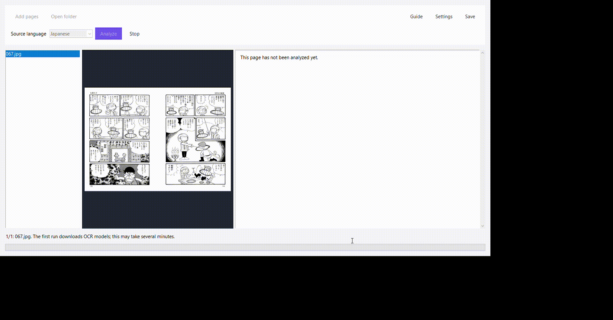

# Manga Reader

I am developing a local desktop application for manga OCR, dialogue translation, and page analysis. It recognizes text with PaddleOCR and optionally uses Ollama to translate dialogue and describe scenes in English.

## Demo



## Features

- Open page images or a chapter folder in natural filename order.
- Recognize Japanese, English, or Russian text and display detected regions with confidence scores.
- Translate dialogue and analyze scenes with a local Ollama model, or use OCR alone.
- Export recognized text, coordinates, and analysis as JSON or TXT.

## Quick start

**Requirements:** Windows and Python 3.12. Ollama is optional.

1. Download or clone this repository and open its folder.
2. Run `Install.cmd`, then `Launch.cmd`.
3. For OCR only, open **Settings** and clear **Scenes, characters and story (Ollama)**.
4. Add pages, select the source language, and click **Analyze**. Use **Save** to export results.

For translation and scene analysis, install and start [Ollama](https://ollama.com/download/windows), then download the default model:

```powershell
ollama pull qwen3-vl:4b-instruct
```

Enable **Scenes, characters and story (Ollama)** in **Settings** before processing.

Supported images: JPG, JPEG, PNG, WebP, BMP, and TIFF. OCR models download on the first run. See the [setup and troubleshooting guide](START.md).

## Stack and status

**Python · Tkinter · Pillow · PaddleOCR (PP-OCRv5, CPU) · Ollama (`qwen3-vl:4b-instruct`)**

The application is under development. OCR and generated analysis can contain errors, and CPU processing can be slow. Results stay in memory until export. I plan to evaluate Manga OCR for recognition alongside PaddleOCR detection.

## Documentation

- [Architecture, image processing, and planned improvements](docs/application.md)
- [Limitations and known issues](docs/limitations.md)
- [OCR comparison: models, methodology, and results](docs/experiment-results.md)
- [Research overview, reproduction, and my contribution](docs/research-guide.md)
- [Application verification report](docs/verification.md)
