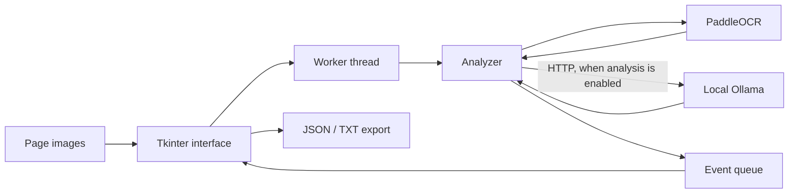

# Application architecture and processing

[Back to the project](../README.md)

## Current architecture

I build Manga Reader as a local desktop application with separate interface and processing modules. The main application runs in one process; Ollama runs separately and is accessed through a local HTTP API.

| Component | Responsibility |
| --- | --- |
| [`manga_app/app.py`](../manga_app/app.py) | Tkinter interface, page list, preview, processing queue controls, result display, and export |
| [`manga_app/engine.py`](../manga_app/engine.py) | Image loading, the `Analyzer` class, OCR calls, and Ollama requests |
| [`manga_app/session.py`](../manga_app/session.py) | Versioned session storage, validation, relative image paths, and atomic writes |
| PaddleOCR | Page text detection and recognition, region coordinates, and confidence; the application uses CPU |
| Ollama | Local image analysis, dialogue translation, and scene descriptions; the default model is `qwen3-vl:4b-instruct` |
| `queue.Queue` | Status and result delivery from the worker thread to the interface |

Pages are processed sequentially in a background thread so long model calls do not block the interface. For each page, I first run PaddleOCR. If story analysis is enabled, I send Ollama a resized image, recognized text, and shortened context from earlier pages in the current run. OCR-only mode does not call Ollama.

Results remain in memory until export or manual session saving. Stopping ends the queue after the current page. If an Ollama analysis request fails after successful OCR, the recognized text is retained with a warning.

PaddleOCR currently handles both detection and recognition, providing the coordinates needed to draw regions on the page. I use it as a ready-to-integrate pipeline. Among the three baseline OCR systems evaluated on 3116 crops, Manga OCR produced the most accurate transcriptions.

## From image loading to OCR results

I organize page processing as follows:

1. **Add images.** The user selects files or a folder. The application accepts the supported image extensions, removes duplicate paths, and sorts filenames naturally: 1, 2, 10. The selected page appears in the preview.
2. **Start processing.** **Analyze** captures the source language and analysis settings, then processes all added pages sequentially in a worker thread. If Ollama analysis is enabled, the application first checks the service and selected model.
3. **Prepare the image.** `load_image()` opens the file with Pillow, applies its EXIF orientation, and converts it to RGB. The result record includes the path and the prepared image's width and height.
4. **Initialize OCR.** `Analyzer.initialize_ocr()` loads PaddleOCR on the first call or a language change. The application uses PP-OCRv5 on CPU. Document orientation classification, document unwarping, and text-line orientation are disabled. Model downloads may be needed on the first run.
5. **Detect and recognize text.** The RGB image becomes a NumPy array, its channels are reordered to BGR, and it is passed to `PaddleOCR.predict()`. PaddleOCR performs detection and recognition. The application does not separately downscale, binarize, or denoise the page before this call; PaddleOCR handles its internal preprocessing.
6. **Build the OCR record.** The application extracts `rec_texts`, `rec_scores`, and `rec_polys`. Each region has `text`, `confidence`, and `polygon` fields. Regions are sorted into horizontal bands 100 pixels high, right to left within a band for Japanese and left to right for the other languages. This approximate order does not recover panel structure.
7. **Display the result.** In OCR-only mode, the record is sent through `queue.Queue` to the main thread. The interface stores it in memory and updates progress. For the selected page, it lists recognized fragments with confidence percentages and draws numbered region outlines. Outlines are drawn before the image is reduced for display, so they scale with the preview.
8. **Export or save a session.** **Export** writes JSON containing text, confidence, and coordinates, or a TXT representation. **Save session** also preserves page order, selection, and settings for **Open session** to restore later.

With story analysis enabled, an additional Ollama request runs between steps 6 and 7. It receives an image copy bounded by 2048 × 2048 pixels, OCR text, and shortened previous-page context. English analysis and dialogue translations are added to the same record. This resized copy is for Ollama, not for the OCR call.

An image-reading error or an OCR failure in OCR-only mode creates an error record for the page. If OCR fails while story analysis is enabled, the application can continue with direct image analysis and add a warning. If subsequent Ollama analysis fails, existing recognized text is preserved. An empty region list is shown as no text found; OCR confidence is not measured transcription accuracy.

## Session persistence

I store sessions as versioned `.manga-session.json` files. Each page references its source image and optionally contains its result, preserving pending pages as well as OCR, analysis, warnings, and errors. Settings include the source language, Ollama mode, and model name.

I validate a session completely before replacing the current workspace. Opening it does not initialize OCR or call Ollama. Missing images leave saved text available. Paths are relative to the session file when possible, so the session and images can move together; paths on another drive stay absolute.

I write to a temporary file in the same directory, flush it, and atomically replace the destination. Failed writes leave an existing session intact. The interface tracks changes and offers to save before closing, clearing, or replacing the session. Opening is disabled during processing; saving captures completed results at that moment. Saving is manual, and restarting analysis still processes every added page.

## Planned improvements

The architecture is still being refined. I plan to evaluate **PaddleOCR for detection, Manga OCR for crop recognition, and Ollama for page analysis**. This combination is not implemented in the application yet. Before adopting it, I need to evaluate full-page detection separately and compare accuracy and runtime with the current pipeline.

